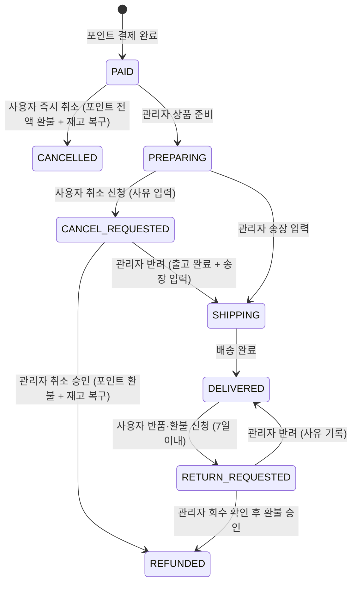
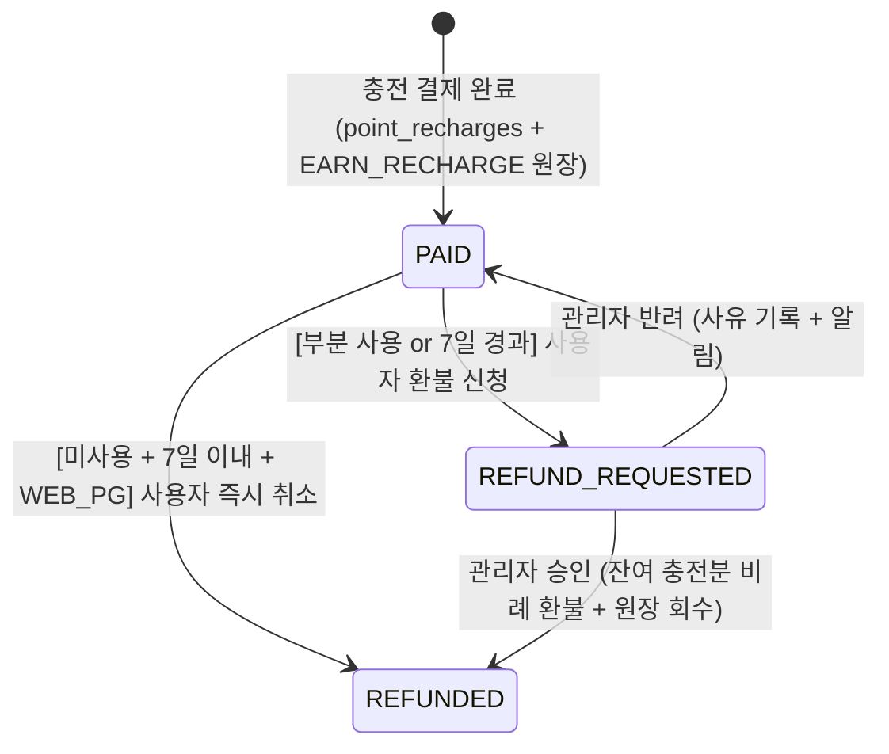

# 주문 취소 · 반품 및 포인트 충전 환불 프로세스 설계서

> **작성일**: 2026-11-23  
> **범위**: `(mobile)` `/app/shop/orders` · `/app/wallet` ↔ `(admin)` `/admin/orders` · `/admin/recharges` · `/admin/users/[id]` ↔ `@repo/db` (`06_points.ts`, `07_commerce.ts`)  
> **기준 정책**: `GM-103` (미사용 충전분 결제 후 7일 이내 전액 PG 취소 · 부분 사용 잔여분 관리자 수동 환불 · 무상 적립분 환불 불가 · 환불 기준 `paid_points`)

---

## 1. 현황 진단 (As-Is) 및 2가지 취소·환불의 본질 구분

와글의 취소·환불은 자금 흐름과 정책이 완전히 다른 **2개 축**으로 분리해 설계해야 합니다.

| 구분 | ① 제품(주문) 취소 · 반품 | ② 포인트 충전 결제 취소 · 환불 |
| :--- | :--- | :--- |
| **자금 흐름** | 포인트 차감 ↔ **포인트 지갑 복구** (내부 원장) | 현금/카드(PG·IAP) 결제 ↔ **현금/PG 결제 취소** (외부 정산) |
| **사용자 진입점** | `/app/shop/orders` (주문 · 배송 조회) | `/app/wallet` (포인트 지갑 → 충전 내역) |
| **관리자 처리점** | `/admin/orders` (주문 · 배송 관리) | `/admin/recharges` (포인트 충전 · 환불 관리) + `/admin/users/[id]` |
| **현재 구현 상태** | `PAID` 즉시 취소만 존재 (**재고 복구 누락**, `SHIPPING`/`REFUNDED` 라벨 불일치, `취소 신청` 상태 없음) | **미구현** (`RechargeClient` 7일 취소 안내 문구와 DB `point_recharges.refunded_at`만 존재) |

---

## 2. 핵심 설계 Brainstorm (옵션 비교)

### 2.1 상태 저장 구조 (DB 스키마 전략)

#### Option A (추천 · KISS): 기존 `orders` / `point_recharges` 테이블에 최소 상태 + 사유 컬럼 확장
- `order_status` ENUM 추가: `CANCEL_REQUESTED`, `RETURN_REQUESTED`
- `recharge_status` ENUM 추가: `REFUND_REQUESTED`
- 최소 컬럼 추가:
  - `orders`: `cancel_reason (text)`, `admin_reject_reason (text)`
  - `point_recharges`: `refund_reason (text)`, `refunded_point_amount (bigint)`, `refunded_cash_amount (bigint)`, `admin_reject_reason (text)`
- ✅ **Pros**: 별도 클레임 테이블 없이 기존 목록·조회·트랜잭션에 1:1 직결. 조인/동기화 복잡도 0.
- ❌ **Cons**: 동일 주문의 부분 품목 반품(예: 3개 중 1개만 반품)이나 다회 재신청 이력까지 분리 저장하긴 어려움.
- 📊 **Effort**: Low ~ Medium

#### Option B: 통합 `refund_requests` 클레임 테이블 신설
- 주문 취소·반품과 충전 환불 신청을 `refund_requests (target_type, target_id, status, requested_amount, ...)` 단일 테이블로 정규화.
- ✅ **Pros**: 부분 품목 취소/반품, 재신청 이력, 관리자 통합 CS 큐 확장에 유리.
- ❌ **Cons**: `orders.status` / `point_recharges.status`와 상태 이중 관리 필요(동기화 버그 위험), 현재 1인/초기 운영 규모 대비 과설계.
- 📊 **Effort**: High

#### Option C: 미사용 즉시 취소만 구현 + 나머지는 1:1 CS 수동 처리
- `PAID` 주문 즉시 취소, 미사용 7일 이내 충전 즉시 취소만 자동화하고, 배송 중/부분 사용 건은 버튼 없이 고객센터(외부 채널)로 안내 후 관리자가 수동 처리.
- ✅ **Pros**: 스키마 변경 0건, 구현 속도 최단.
- ❌ **Cons**: 사용자가 앱 안에서 "내 취소 신청이 접수됐는지 / 반려됐는지" 상태를 확인할 수 없음.
- 📊 **Effort**: Low

> **권장**: **Option A** — 지금 당장 필요한 **즉시 취소 + 취소 신청 + 관리자 승인/반려** 전 과정을 별도 테이블 증식 없이 가장 단순하고 단단하게 닫을 수 있습니다.

---

### 2.2 관리자 콘솔 메뉴 배치 전략

#### Option 1 (추천): 커머스 섹션에 `포인트 충전 · 환불` (`/admin/recharges`) 독립 메뉴 추가
- 기존 `커머스` 사이드바 섹션:
  - `A-07` 포인트샵 상품 · 카테고리 (`/admin/products`)
  - `A-08` 주문 · 배송 관리 (`/admin/orders`) — 주문 취소/반품 승인·반려 포함
  - `A-09(신설)` 포인트 충전 · 환불 (`/admin/recharges`) — PG/IAP 충전 결제 내역, 환불 신청 큐, 미사용/잔여 충전분 환불 승인·반려
- `/admin/users/[id]` 회원 상세에서도 해당 회원의 최근 충전 내역 조회 및 환불 바로가기 제공.
- ✅ **Pros**: "현금 매출/PG 취소(회계·정산)"와 "실물 상품 배송/재고(물류)" 업무가 깔끔하게 분리됨.
- ❌ **Cons**: 사이드바 메뉴 1개 증가 (`MENU_REGISTRY` 등록 필요).

#### Option 2: `/admin/orders` 상단에 `[상품 주문 | 포인트 충전]` 2탭 통합
- 사이드바 메뉴를 늘리지 않고 `/admin/orders?tab=orders|recharges`로 통합.
- ✅ **Pros**: 사이드바 슬림 유지.
- ❌ **Cons**: 필터 조건(송장/택배사 vs PG채널/잔여포인트)이 달라 화면 코드가 비대해짐.

> **권장**: **Option 1** — 현금 결제 취소(PG/정산)와 실물 주문 배송은 운영 담당과 필터 축이 다르므로 분리하는 편이 실무 관리에 훨씬 편합니다.

---

## 3. 도메인별 상태 머신 & 처리 규칙

### 3.1 ① 제품(주문) 취소 · 반품 프로세스 (`/app/shop/orders` ↔ `/admin/orders`)

#### 주문 상태별 사용자 UI & 처리 정책
| 주문 상태 | 한글 배지 | 사용자 액션 버튼 | 처리 방식 | 재고 복구 |
| :--- | :--- | :--- | :--- | :---: |
| `PAID` | 결제 완료 | **`주문 취소`** | **즉시 취소** (`CANCELLED`) + 원본 `paidPoints` 전액 환불 | ✅ 자동 복구 |
| `PREPARING` | 배송 준비 | **`취소 신청`** | 사유 입력 후 `CANCEL_REQUESTED` 전이 → 관리자 승인 대기 | 승인 시 복구 |
| `CANCEL_REQUESTED` | 취소 요청 중 | **`취소 요청 철회`** (선택) | 진행 중 안내 + 요청 사유 표시 | - |
| `SHIPPING` | 배송 중 | 버튼 숨김 (안내 문구) | 배송 완료 후 반품 신청 가능 안내 | - |
| `DELIVERED` | 배송 완료 | **`반품 · 환불 신청`** (실물 · 7일 이내) | 사유 입력 후 `RETURN_REQUESTED` 전이 → 관리자 검수 | 관리자 선택(양품 시 복구) |
| `RETURN_REQUESTED` | 반품 요청 중 | 진행 상태 배지 | 회수 및 검수 대기 안내 | - |
| `CANCELLED` / `REFUNDED` | 취소 완료 / 환불 완료 | 없음 | 환불 완료 일시 + 환불 포인트 표시 | 완료 |

> **디지털 상품 예외 (`PREMIUM_UNLOCK` · `INQUIRY_TICKET`)**:
> - `PREMIUM_UNLOCK`은 결제 직후 `course_unlocks`가 부여되어 `DELIVERED`로 생성됩니다.
> - **미수강(해당 코스 진도 0건) + 7일 이내**인 경우에만 취소/환불 허용 + `course_unlocks` 소프트 삭제(`is_deleted = true`), 수강 이력이 1건이라도 있으면 환불 불가 안내.

#### 기존 코드 즉시 보강 대상 (선행 버그 2건)
1. [walletShopActions.ts:L434-L457](file:///d:/01.업무/2026/와글/05.HTML/waggle-apps/apps/web/src/03_actions/web/walletShopActions.ts#L434-L457) 및 [adminCommerceActions.ts:L309-L332](file:///d:/01.업무/2026/와글/05.HTML/waggle-apps/apps/web/src/03_actions/admin/adminCommerceActions.ts#L309-L332): 주문 취소/환불 트랜잭션에 `order_items` 기반 **`products.stock` / `product_variants.stock` 원복** 추가.
2. [orders/page.tsx:L9-L15](file:///d:/01.업무/2026/와글/05.HTML/waggle-apps/apps/web/src/app/(mobile)/app/shop/orders/page.tsx#L9-L15): `SHIPPED` → `SHIPPING` 수정, `REFUNDED` / `CANCEL_REQUESTED` / `RETURN_REQUESTED` 라벨 및 배지 톤 반영.

---

### 3.2 ② 포인트 충전 결제 취소 · 환불 프로세스 (`/app/wallet` ↔ `/admin/recharges`)

#### 충전 건별 자동 판별 로직 (서버 단일 계산 — 클라이언트 신뢰 금지)
각 `point_recharges` 건(`status === 'PAID'`)은 적립 시 생성된 `point_ledgers` (`ref_type = 'recharge'`, `ref_id = recharge.id`, `reason = 'EARN_RECHARGE'`) 행과 1:1 매핑됩니다.

- **`usedPoints` = `point_recharges.pointAmount - ledger.remainingAmount`**
- **`isUnused`** = `ledger.remainingAmount === point_recharges.pointAmount` (FIFO 차감 이력 0P)
- **`within7Days`** = `Date.now() - recharge.paidAt.getTime() <= 7 * 24 * 60 * 60 * 1000`

| 조건 | 사용자 화면 (`/app/wallet` → `충전 내역` 탭) | 처리 주체 & 방식 |
| :--- | :--- | :--- |
| **`WEB_PG` + 미사용 + 7일 이내** | **`바로 취소`** (border 버튼) | **즉시 처리**: PortOne 결제 취소(개발/테스트 Mock 분기) → 원장 차감(`remainingAmount = 0`, 지갑 잔액 `-pointAmount`) → `point_recharges.status = 'REFUNDED'` |
| **`WEB_PG` + 부분 사용 (잔여 > 0)** 또는 **7일 경과 (미사용/잔여 > 0)** | **`환불 신청`** (사유·계좌/확인 시트) | **관리자 승인**: `REFUND_REQUESTED` 전이 → 관리자 `/admin/recharges`에서 잔여분 확인 후 부분/전액 환불 실행 또는 반려 |
| **전액 사용 완료 (`remainingAmount === 0`)** | 버튼 없음 (`사용 완료` 배지) | 환불 불가 |
| **`IOS_IAP` / `ANDROID_IAP`** | **`스토어 환불 안내`** (정보 모달) | Apple App Store / Google Play 정책상 스토어 환불 절차 안내 (스토어 환불 통지 수신 또는 관리자 수동 회수 시 원장 반영) |

> **부분 사용 환불 금액 계산 기준 (GM-103)**:
> - 환불 가능 포인트 = `min(ledger.remainingAmount, point_wallets.balance)`
> - 환불 원화 금액 = `Math.floor(recharge.paidAmount * (refundablePoints / recharge.pointAmount))` (보너스/무상 적립분 제외, 실결제 원가 비례)

---

## 4. ACID 트랜잭션 & 멱등성 안전 규약

1. **잠금 순서 고정 (데드락 원천 차단)**:
   - 모든 취소/환불 트랜잭션은 항상 **`point_wallets` (`FOR UPDATE`) → 대상 엔티티(`orders` / `point_recharges`) → `point_ledgers`** 순으로 잠급니다.
2. **이중 환불 차단 (Idempotency)**:
   - 주문 취소/환불 원장 멱등키: `order-refund:{order.id}` (사용자 취소와 관리자 환불이 같은 키 계열을 공유하거나, 선행 상태 `PAID/CANCEL_REQUESTED/RETURN_REQUESTED` 조건부 `UPDATE ... WHERE status IN (...) RETURNING id`로 동시 실행 0건 보장).
   - 충전 취소 원장 멱등키: `recharge-refund:{recharge.id}` + 해당 `EARN_RECHARGE` 원장의 `remaining_amount`를 `0`으로 즉시 업데이트해 소멸 배치나 후속 사용/재환불에서 절대 재참조되지 않게 차단.
3. **외부 PG API 호출 시 트랜잭션 경계 (실연동 대비)**:
   - DB 트랜잭션 내부에서 외부 PortOne HTTP 호출을 오래 물고 있지 않도록 2단계 전이 권장:
     1. 짧은 TX로 상태 선점 + 잔여량 재검증
     2. PortOne Cancel API 호출 (개발/Mock 환경은 즉시 성공 어댑터)
     3. 성공 시 최종 TX로 `REFUNDED` + 원장 차감 + 알림(`notifications`) + 감사 로그(`audit_logs`) 커밋 (실패 시 원복 + 에러 반환)
4. **감사 로그 & 알림 필수 연동**:
   - 관리자 승인/반려 전건 `audit_logs` 기록 (`order.cancel_approve`, `order.cancel_reject`, `recharge.refund_approve`, `recharge.refund_reject`).
   - 상태 확정 시 보호자에게 `notifications` 즉시 적재 (`ORDER_UPDATE`, `POINT_REFUNDED`).

---

## 5. 화면별 UI/UX 구성 요약

### 5.1 사용자 `(mobile)`
1. **`/app/shop/orders` (주문 · 배송 조회)**
   - 주문 카드 하단에 상태별 단일 액션 노출:
     - `PAID`: `주문 취소` (확인 Alert → 즉시 취소 + 포인트 환불)
     - `PREPARING`: `취소 신청` (사유 선택/입력 시트 → `CANCEL_REQUESTED`)
     - `DELIVERED` (실물 · 7일 이내): `반품 · 환불 신청` (사유 시트 → `RETURN_REQUESTED`)
     - `CANCEL_REQUESTED` / `RETURN_REQUESTED`: 상태 배지 + 신청 사유 표시 + `요청 철회` 링크
2. **`/app/wallet` (포인트 지갑)**
   - 상단 보유 포인트 카드 아래 `AppSegmented` 2탭 배치:
     - **`포인트 내역`**: 기존 전체 원장 (`적립 / 사용 / 환불 / 소멸`)
     - **`충전 · 환불 내역`**: `point_recharges` 결제 목록 (결제일 `YYYY.MM.DD HH:mm`, 결제액 원화, 충전 포인트, 남은 포인트, 상태 배지, 우측 **`바로 취소`** 또는 **`환불 신청`** border 버튼)

### 5.2 관리자 `(admin)`
1. **`/admin/orders` (주문 · 배송 관리)**
   - 상단 상태 필터 탭 추가: `전체` · `결제완료(PAID)` · **`취소/반품 요청(N건 배지)`** · `배송중` · `완료/환불`
   - `CANCEL_REQUESTED` / `RETURN_REQUESTED` 행에 사용자 신청 사유 표시 + **`취소/환불 승인`** (포인트 환불 + 재고 복구 체크박스) / **`반려`** (반려 사유 입력) 버튼 제공.
2. **`/admin/recharges` (포인트 충전 · 환불 관리 — 신설 `A-09`)**
   - 상단 필터: `전체` · `결제완료(PAID)` · **`환불 요청(N건 배지)`** · `환불완료(REFUNDED)` + 채널 필터(`WEB_PG` / `IOS_IAP` / `ANDROID_IAP`).
   - 고밀도 테이블 컬럼: `결제일시` · `회원` · `채널/패키지` · `결제금액(원)` · `충전 / 잔여 포인트` · `상태` · `신청사유` · `처리(승인/반려)`.
   - 미사용/부분사용 잔여분 자동 계산 표시 + 승인 시 확인 모달(`환불 원화 / 회수 포인트` 명시) → 원장 회수 + `REFUNDED` + `audit_logs` 기록.
3. **`/admin/users/[id]` (회원 상세)**
   - 기존 수동 지급/회수 패널 하단에 해당 회원의 최근 `충전 내역` 요약 및 `/admin/recharges?userId={id}` 바로가기 연결.

---

## 6. 단계별 구현 로드맵

| Phase | 작업 범위 | 산출물 |
| :---: | :--- | :--- |
| **Phase 1** | DB 스키마 확장 + 주문 취소 버그 수정 | `06_points.ts` · `07_commerce.ts` ENUM/컬럼 추가 및 `drizzle-kit push`, `cancelMyOrderAction`·`adminCancelOrderRefundAction` **재고 복구** 추가, `orders/page.tsx` 상태 라벨 정리 |
| **Phase 2** | 사용자 셀프 취소 · 환불 신청 UI/Action | `/app/shop/orders` 취소·반품 신청 시트 & `requestOrderCancelAction` / `withdrawOrderCancelAction`, `/app/wallet` 2탭(`포인트 내역 | 충전 내역`) + `cancelMyRechargeAction`(미사용 7일 즉시) / `requestRechargeRefundAction`(부분사용·기간경과 신청) |
| **Phase 3** | 관리자 승인 · 반려 콘솔 | `/admin/orders` 요청 필터·승인/반려 액션, `/admin/recharges` 페이지 신설(`MENU_REGISTRY` 등록) + `adminApproveRechargeRefundAction` / `adminRejectRechargeRefundAction`, `/admin/users/[id]` 연동, `audit_logs`·`notifications` 검증 |

---

## 7. 최종 확정 결정 사항 (2026-11-23 확정)

1. **미사용 + 7일 이내 `WEB_PG` 충전 취소**: 사용자 `바로 취소` 클릭 시 **즉시 환불 완료(`REFUNDED`)** + 원장 회수(`RECHARGE_REFUND`, `remaining_amount = 0`). 부분 사용 또는 7일 경과 시 **`환불 신청` (`REFUND_REQUESTED`)** → 관리자 승인/반려.
2. **주문 취소 · 반품 및 배송지 변경 경계 통일 (`PAID` 기준)**:
   - **`PAID` (결제 완료)**: **`배송지 변경`** (바텀시트 즉시 반영 + 기본 배송지 저장 선택) + **`주문 취소`** (즉시 취소 + 포인트 전액 환불 + **재고 원복**).
   - **`PREPARING` (배송 준비)**: 출고 착수 구간으로 배송지 즉시 변경 차단 + **`취소 신청`** (`CANCEL_REQUESTED`) → 관리자 승인/반려.
   - **`SHIPPING` (배송 중)**: 변경·취소 불가 (송장 조회).
   - **`DELIVERED` (배송 완료 · 실물 7일 이내)**: **`반품 · 환불 신청`** (`RETURN_REQUESTED`) → 관리자 검수 후 승인/반려.
   - 주문서(`/app/shop/checkout`) 초기 배송지도 최근 저장된 `addresses` 기본 배송지를 자동 로드하도록 연동.
3. **관리자 콘솔 배치**: 커머스 섹션에 **`/admin/recharges` (`A-14` 포인트 충전 · 환불)** 독립 메뉴 신설 + `/admin/orders` 요청 필터·승인/반려 보강 + `/admin/users/[id]` 충전 내역 연동.
