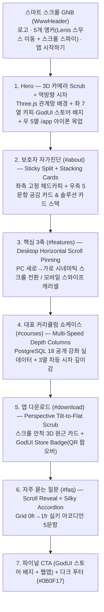

# 와글 `(www)` 실서비스 마케팅 랜딩 개편 설계서

> **작성일**: 2026-11-27  
> **대상 영역**: `apps/web/src/app/(www)/` (공개 소개 페이지 전용 — `(mobile)` `/app/*` 및 `(admin)` `/admin/*`과 100% 물리 격리)  
> **레퍼런스**: MindGym `(marketing)` 7섹션 풀 구조 (PWA 브라우저 가이드 대신 **iOS App Store · Android Google Play 네이티브 앱 설치** 중심으로 재구성)

---

## 1. 개편 목표 및 핵심 원칙

1. **실서비스 보호자 전용 마케팅 페이지 전환**
   - 기존 개발·운영용 노출 요소(**`Admin 콘솔` 버튼/링크, `PostgreSQL 18 latencyMs` 배지, `3-Domain 물리 격리 아키텍처` 블록, `Next.js 16.2.6` 기술스택 푸터**)를 **100% 제거**합니다.
   - 모든 카피·시각 요소·CTA를 실제 반려견 보호자 관점의 서비스 소개와 앱 설치·`/app` 진입 전환에 집중합니다.
2. **네이티브 앱 설치 (iOS App Store · Android Google Play) 중심 동선**
   - 브라우저 홈 화면 추가(PWA) 가이드는 제외하고, **GodUI Store Badge**(`https://godui.design/docs/lab/layout/store-badge`) 디자인 스펙 기반의 **iOS App Store / Android Google Play 공식 스토어 배지 버튼**과 전용 **앱 다운로드 섹션(`#download`)**을 배치합니다.
   - 스토어 URL은 환경변수(`NEXT_PUBLIC_IOS_STORE_URL`, `NEXT_PUBLIC_ANDROID_STORE_URL`)로 연동하며, 미설정(출시 전) 상태에서는 깔끔한 출시 안내 + `/app` 바로 시작 동선으로 안전하게 폴백합니다.
3. **와글 디자인 시스템 100% 정합 (`styles/web.css`) + 멀티 패턴 Parallax Scrollytelling (`GSAP ScrollTrigger` + `Lenis`)**
   - 사용자 4색 OKLCH 브랜드 테마(`orange` 기본 · `green` · `sky` · `coral`) 및 라이트/다크 모드(`data-web-mode`) 0ms FOUC 자동 연동.
   - 전역 `superellipse(1.3)` 3단 라운드 체계 준수, **Purple Ban(MindGym `indigo` 제거 → `brand`/`emerald`/`sky`/`amber` 치환)**, UI 이모지 전면 금지(`lucide-react` + `WaggleMark`/`WaggleWordmark` + Apple/Google Play 브랜드 SVG).
   - **전용 스킬 `@parallax-scrollytelling` 기반 멀티 패턴 패럴랙스 + Lenis 관성 스크롤**:
     - `(www)` 루트(`WwwScrollProvider.tsx`)에 **Lenis 관성 스크롤 ↔ GSAP `ticker` 단일 rAF 동기화**를 완전 격리 탑재(언마운트 시 `lenis.destroy()`로 `/app`·`/admin` 네이티브 스크롤 간섭 0%).
     - `gsap.matchMedia()`로 **데스크톱(`≥1024px`) 풀 패럴랙스(3D 카메라 Scrub · Sticky 카드 스택 · 가로 스크롤 Pinning · 다층 속도 시차 · 원근 Tilt-to-Flat)**와 **모바일(`<1024px`) 네이티브 터치/스와이프 + `prefers-reduced-motion` 해제**를 자동 분기합니다.

---

## 2. 정보 구조 (7섹션 + 스마트 헤더 + 다크 푸터)

### 2.0 섹션별 멀티 패턴 Parallax 연출표 (`WwwScrollProvider.tsx` · `@parallax-scrollytelling`)
| 섹션 | Parallax 아키타입 | 데스크톱 (`≥1024px`) 동작 | 모바일 (`<1024px`) / 저모션 |
| :--- | :--- | :--- | :--- |
| **전역 쉘** | **Lenis 관성 스크롤** | `duration: 1.15`, `smoothWheel: true`, GSAP `ticker` 단일 루프 동기화 + 상단 스크롤 진행 바 | Lenis 미활성(네이티브 터치 100% 보존) |
| **1. Hero** | **3D 카메라 플라이스루 Scrub + 역방향 깊이감** | 스크롤 시 Three.js 3D 관계망 카메라 줌인/오빗 + 아이폰 3D 목업 역방향 시차(`y: -64`) | 경량 3D 관계망 + 자연스러운 수직 흐름 |
| **2. Self-Check (`#about`)** | **Sticky Split + Stacking Cards** | 좌측 타이틀·진행 칩 `sticky` 고정 + 우측 6장 카드가 순차 스택되며 이전 카드 미세 축소(`scale: 0.97`) | 깔끔한 2열/1열 순차 등장 |
| **3. Core Pillars (`#features`)** | **Horizontal Scroll Pinning** | 뷰포트 고정(`pin: true`) 후 세로 스크롤로 3개 대형 기능 패널을 가로 슬라이드 탐색 + 진행률 바 | 가로 스와이프 스냅 캐러셀 + 도트 |
| **4. Courses (`#courses`)** | **Multi-Speed Depth Columns** | 3개 열이 서로 다른 스크롤 시차(`±24px / ±48px / ±20px`)로 입체 교차 이동 | 가로 스와이프 / 1열 깔끔 배치 |
| **5. App Download (`#download`)** | **Perspective Tilt-to-Flat Scrub** | 진입 시 `rotateX(8deg) scale(0.94)` → 중앙 도달 시 정면 안착 + 플로팅 하이라이트 칩 역방향 시차 | 정적 진입 + 즉시 인터랙션 |

### 2.1 스마트 스크롤 헤더 (`WwwHeader.tsx`)
- **좌측**: `WaggleWordmark` (클릭 시 최상단 스무스 스크롤)
- **중앙 (PC `md+`)**: 순수 텍스트 앵커 5종 + 활성 섹션 하단 브랜드 도트 인디케이터 (`IntersectionObserver` 스크롤 스파이)
  - `공감 체크 (#about)` · `핵심 기능 (#features)` · `커리큘럼 (#courses)` · `앱 설치 (#download)` · `FAQ (#faq)`
- **우측**: `와글 시작하기` Primary CTA (`/app`) — **Admin 버튼 없음**
- **모션**: 스크롤 다운(`>200px`) 시 부드럽게 숨김, 스크롤 업 시 글래스 블러(`backdrop-blur-2xl`) 복귀 + 모바일 햄버거 슬라이드 메뉴.

### 2.2 Section 1 — Hero (`WwwHeroSection.tsx` + `WwwHeroNetworkCanvas.tsx`)
- **배경 레이어 — Three.js WebGL 3D 관계망 (`WwwHeroNetworkCanvas.tsx`, `@threejs-nextjs` 준수)**:
  - `three` 순수 바닐라 + `next/dynamic({ ssr: false })` 지연 로드, `alpha: true` 투명 캔버스 + 좌측 텍스트 가독성 보호용 Radial Mask.
  - **노드 3계층 관계망 (보호자 ↔ 멍멍이 ↔ 맞춤 강좌)**:
    - **멍멍이 노드 (10~12종)**: `apps/web/public/images/breeds/*.webp` 기존 견종 사진(`poodle-toy`, `bichon`, `pomeranian`, `welsh-corgi`, `golden-retriever`, `shiba`, `maltese`, `samoyed`, `maltipoo`, `cocker-spaniel` 등)을 원형 알파 `CanvasTexture` + `THREE.Sprite`로 3D 공간에 배치.
    - **강좌 / 루틴 노드 (5~6개)**: 실제 공개 강좌명·키워드 필(`기초 생활 매너`, `여유로운 산책`, `분리불안 교정`, `데일리 기록`, `1:1 영상 Q&A`) 고해상도 한글 `CanvasTexture` 스프라이트.
    - **보호자 · 연결선 & 펄스**: `THREE.LineSegments` 연결망 + 선을 따라 흐르는 브랜드 컬러 빛 패킷(`THREE.Points`) + 마우스 이동 3D 패럴랙스 오빗.
  - **성능·테마 가드레일**: DPR ≤ 2, `IntersectionObserver` 뷰포트 이탈 시 `rAF` 자동 정지, `prefers-reduced-motion` 정적 1프레임, `MutationObserver`로 4색 테마·다크 모드 `--color-brand` 실시간 동기화, 완전한 GPU `dispose()` + WebGL 미지원 폴백.
- **좌측 (7열)**:
  - 상단 펄스 배지: `반려견 맞춤 교육 · 데일리 기록 앱`
  - 메인 헤드카피: `매일 5분 맞춤 교육으로` / `우리 강아지가 달라져요` (브랜드 포인트 컬러 강조)
  - 서브 설명: 성향 설문 매칭부터 3단계 교육 루프, 데일리·건강 기록, 포인트샵·훈련사 1:1 영상 Q&A까지 한 곳에서.
  - 핵심 가치 칩 3종 (`data-reveal="pop"` 순차 팝업): `성향 설문 맞춤 매칭` · `영상·실습·퀴즈 3단계` · `데일리 기록 & 포인트샵`
  - **CTA 영역**:
    - 메인 버튼 2종: `와글 앱 시작하기` (`/app`, Primary) + `앱 설치하기` (`#download`, Secondary)
    - 하단 스토어 퀵 배지: **App Store (iOS)** · **Google Play (Android)** 컴팩트 스토어 버튼 2종 나란히 배치
- **우측 (5열) — 티타늄 아이폰 3D 디바이스 목업**:
  - MindGym의 티타늄 베젤·물리 버튼·다이내믹 아일랜드·사선 글래스 반사 목업 구조 이식.
  - 내부 스크린: 실제 와글 `/app` 홈 화면을 `390×844` @2x로 캡처 후 `sharp`로 WebP 최적화(`apps/web/public/images/www/app-home-preview.webp`, ≤ 120KB)해 탑재.
  - 후면 앰비언트 글로우: `var(--color-brand)` 기반 블러 헤일로(4색 테마 자동 연동).

### 2.3 Section 2 — 보호자 자가진단 (`#about`, `WwwSelfCheckSection.tsx`)
- 2열 그리드: **5문항 공감 체크리스트** + **6번째 와글 솔루션 강조 카드** (`data-reveal="pop"` 90ms 스태거).
  1. 산책할 때마다 리드줄을 당기거나 다른 강아지에게 짖어 난감하다
  2. 현관문 소리·외출 시 짖음과 분리불안 때문에 늘 마음이 쓰인다
  3. 유튜브 교육 영상을 봐도 우리 강아지에게 맞는 순서가 헷갈린다
  4. 바쁜 일상 속에서 길게 훈련할 시간 없이 매일 5분 루틴이 필요하다
  5. 예방접종 일정, 체중 변화, 산책 일기를 한눈에 모아두고 싶다
  - **6번 솔루션 카드**: 브랜드 소프트 그라디언트 강조 박스 (`매일 5분, 우리 강아지 맞춤 루틴`).

### 2.4 Section 3 — 핵심 3축 (`#features`, `WwwCorePillarsSection.tsx`)
- **모바일**: 가로 스와이프 스냅 캐러셀 + 하단 도트 인디케이터 / **PC (`md+`)**: 3열 그리드.
- **마우스 트래킹 오로라 호버 카드** (무보라 3색: `brand` · `emerald` · `sky`):
  1. **맞춤 커리큘럼 & 3단계 교육 루프** (`Personal Curriculum`): 7문항 성향 설문 매칭 + 영상 시청(95%) → 실습 자가체크 → 퀴즈 통과 & 포인트 보상
  2. **데일리 & 건강 캘린더** (`Daily & Health Log`): 월간 데일리 캘린더·사진 갤러리·체중 변화 그래프·예방접종 기록
  3. **포인트샵 & 훈련사 1:1 영상 Q&A** (`Rewards & Trainer Q&A`): 교육 적립 포인트로 간식·프리미엄 강좌 교환 + 행동 영상 업로드 시 48시간 내 전문 훈련사 맞춤 피드백

### 2.5 Section 4 — 대표 커리큘럼 쇼케이스 (`#courses`, `WwwCoursesSection.tsx`)
- **실데이터 연동**: `(www)/page.tsx` 서버 컴포넌트에서 PostgreSQL 18 `courses` + `units`/`lessons`를 조회해 공개 강좌(`isPublished = true`, `isDeleted = false`, 최대 6개)를 전달.
- **카드 구성** (모바일 스와이프 캐러셀 / PC 3열 오로라 카드):
  - 상단: `Lv.N` 표기 + `무료 강좌` / `프리미엄` 뱃지
  - 본문: 강좌 제목 + 강좌 요약 설명
  - 하단: 총 강의 수(`N개 강의`) + `앱에서 시작하기` (`/app`) 링크

### 2.6 Section 5 — 앱 설치 섹션 (`#download`, `WwwAppDownloadSection.tsx`) & GodUI Store Badge 명세 (`StoreBadgeButtons.tsx`)
- **GodUI Store Badge 디자인 스펙 (`https://godui.design/docs/lab/layout/store-badge` 준거, `StoreBadge` / `StoreBadgeGroup`)**:
  - **배치 & 사이즈 프리셋** (인라인 스타일 대신 정적 Tailwind `rem` 클래스 사용, 전역 `superellipse(1.3)` 자동 적용):
    - 그룹 컨테이너(`StoreBadgeGroup`): `flex flex-wrap items-center gap-3`
    - 기본(`md`, `height` `3.25rem` / `52px` 기준 — App Store ≈ `144×52px`, Google Play ≈ `160×52px`): `h-13 px-4 gap-2.5 rounded-xl` (컴팩트 `sm` `h-11 px-3.5 gap-2 rounded-xl` 옵션은 Hero/Footer용)
  - **2종 마감 테마 (`theme`: `"dark"` 기본 | `"light"`)**:
    - `dark`: `bg-black text-white ring-1 ring-white/20` (공식 헤어라인 링)
    - `light`: `bg-white text-black ring-1 ring-black/15`
  - **아이콘 SVG (`viewBox="0 0 24 24"`, `size-[1.6875rem]` / `27px` at `md`)**:
    - **App Store (`AppleLogo`)**: 모노크롬 `fill="currentColor"` (`dark` 화이트 / `light` 블랙)
    - **Google Play (`GooglePlayLogo`)**: 공식 4색 멀티컬러 `<path>` (`#00d0ff` · `#ffce00` · `#ff3d47` · `#00f076`)
  - **타이포그래피 2단 계층** (`flex flex-col items-start leading-none`):
    - 상단 서브라벨: `"Download on the"` (iOS) / `"Get it on"` (Android, sentence case) — `text-[0.5625rem]`(`9px`), `font-medium tracking-wide opacity-90`
    - 하단 메인라벨: `"App Store"` / `"Google Play"` — `text-base`(`16px`), `font-semibold leading-tight mt-0.5`
  - **마이크로 인터랙션 (GPU 전용 · `framer-motion` 미도입 순수 CSS/Tailwind 구현)**:
    - 호버 리프트 & 프레스: `transition-transform duration-200 ease-[cubic-bezier(0.22,1,0.36,1)] hover:-translate-y-0.5 active:scale-[0.98] motion-reduce:transition-none`
    - 대각선 쉰 스윕(Hover Sheen Sweep): 내부 `` 오버레이가 호버 시 `-translate-x-[130%]` → `translate-x-[130%]` (`skew-x-[-12deg] duration-700 ease-out motion-reduce:hidden`, `dark`는 `rgba(255,255,255,0.28)` / `light`는 `rgba(0,0,0,0.08)` 105° 그라디언트)
  - **Scan To Download QR 팝오버 (데스크톱 `pointer: fine` 전용, `#download` 섹션 `qr` 옵션)**:
    - 스토어 URL(`NEXT_PUBLIC_IOS_STORE_URL` / `NEXT_PUBLIC_ANDROID_STORE_URL`)이 설정된 상태에서 데스크톱 호버/포커스 시 배지 상단(`bottom-full left-1/2 mb-3 -translate-x-1/2`)에 QR 팝오버 카드(`rounded-2xl border bg-surface p-3 shadow-xl` + 하단 화살표) 표시.
    - 경량 무의존성 `uqr`로 클라이언트 SVG QR(`shapeRendering="crispEdges"`, 중앙 `WaggleMark` 로고 컷아웃 + ECC `"Q"`) 렌더링 + 순수 CSS 전환 애니메이션(`framer-motion` 배제).
    - **출시 전(URL 미설정) 폴백**: 클릭 시 인라인 안내 배너 또는 `useAlert`로 `"앱 스토어 출시 준비 중입니다 · 지금 바로 웹앱으로 동일하게 이용하실 수 있어요"` 안내 및 `/app` 바로 시작 동선 제공 (QR 팝오버 비활성).
- **섹션 레이아웃 (`#download`, `WwwAppDownloadSection.tsx`)**:
  - 좌측: `APP DOWNLOAD` 라벨 · `iOS · Android에서 더 편하게 만나요` 헤드카피 · 푸시 리마인드, 산책·일상 사진 기록, 빠른 학습 이어하기 안내 + `StoreBadgeGroup` (`md` 사이즈, 데스크톱 `qr` 활성화).
  - 우측: iOS / Android 지원 사양 요약 카드 (푸시 알림 · 다견 프로필 · 빠른 학습 이어하기 · 웹앱 즉시 실행 링크 `/app`).

### 2.7 Section 6 — 자주 묻는 질문 (`#faq`, `WwwFaqSection.tsx`)
- Grid `0fr → 1fr` 실키 아코디언 5문항:
  1. 초보 보호자나 강아지 나이가 많아도 시작할 수 있나요?
  2. 무료로 이용할 수 있는 범위는 어디까지인가요?
  3. 하루에 얼마나 시간을 투자해야 하나요?
  4. 반려견이 여러 마리인데 각각 따로 관리할 수 있나요?
  5. 훈련사 1:1 영상 Q&A는 어떻게 진행되나요?

### 2.8 다크 푸터 (`WwwFooter.tsx`) — `#download` 단일 최종 전환 통합
- **중복 CTA 제거 (6섹션 KISS)**: 별도 `Final CTA` 섹션을 두지 않고, FAQ(`#faq`) 직후 **`#download` (`WwwAppDownloadSection.tsx`)**에 `WaggleMark` + 감성 헤드카피 + GodUI Store Badge(`App Store`/`Google Play`, QR 팝오버) + `설치 없이 웹앱 바로 시작하기`(`/app`)를 단일 최종 전환 섹션으로 통합 배치.
- **다크 푸터 (`#0B0F17`)**:
  - 좌측: 화이트 `WaggleWordmark` + 와글 서비스 소개 + 저작권 (`© 2026 Waggle. All rights reserved.`)
  - 우측: 2열 사용자 전용 서비스 인덱스 (`공감 체크 · 핵심 기능 · 커리큘럼 · FAQ` / `iOS App Store · Android Google Play · 웹앱 바로가기`) — **Admin 링크·서버/기술스택 정보 전면 배제**.

---

## 3. 파일 구성 계획

| 파일 경로 | 구분 | 역할 |
| :--- | :---: | :--- |
| `apps/web/public/images/www/app-home-preview.webp` | 신규 에셋 | 실제 `/app` 홈 화면 WebP 캡처 (아이폰 3D 목업 내부 이미지) |
| `apps/web/src/app/(www)/landing.module.css` | 신규 | ScrollReveal(`text`/`pop`/`mockup`), 오로라 마우스 글로우(무보라 3색), FAQ 아코디언, `prefers-reduced-motion` |
| `apps/web/src/app/(www)/_components/WwwScrollProvider.tsx` | 신규 | `(www)` 전용 Lenis 관성 스크롤 ↔ GSAP `ScrollTrigger` 단일 티커 동기화 + 상단 진행률 바 + 앵커 스무스 스크롤 + 언마운트 완전 정리 |
| `apps/web/src/app/(www)/_components/StoreBadgeButtons.tsx` | 신규 | GodUI Store Badge 디자인 기반 iOS App Store · Google Play 공용 배지(`dark`/`light`, 대각선 Sheen 스윕, 데스크톱 `uqr` QR 팝오버, 출시 전 폴백) |
| `apps/web/src/app/(www)/_components/WwwHeader.tsx` | 신규 | 스마트 스크롤 GNB + 스크롤 스파이 도트 + 모바일 드로어 |
| `apps/web/src/app/(www)/_components/WwwHeroNetworkScene.tsx` | 신규 | Three.js WebGL 3D 관계망 씬(`breeds/*.webp` 원형 스프라이트 + 강좌 필 + 연결선/펄스 + OKLCH 동기화 + GPU `dispose`) |
| `apps/web/src/app/(www)/_components/WwwHeroNetworkCanvas.tsx` | 신규 | `next/dynamic({ ssr: false })` 래퍼 + 좌측 텍스트 가독성 보호 Radial Mask |
| `apps/web/src/app/(www)/_components/WwwHeroSection.tsx` | 신규 | Hero 카피·핵심 칩·CTA·스토어 배지 + Three.js 3D 관계망 배경 + 티타늄 아이폰 3D 목업 |
| `apps/web/src/app/(www)/_components/WwwSelfCheckSection.tsx` | 신규 | 5문항 보호자 공감 체크리스트 + 솔루션 카드 |
| `apps/web/src/app/(www)/_components/WwwCorePillarsSection.tsx` | 신규 | 핵심 3축 오로라 카드 (모바일 캐러셀 / PC 3열) |
| `apps/web/src/app/(www)/_components/WwwCoursesSection.tsx` | 신규 | DB 공개 강좌 실데이터 쇼케이스 (모바일 캐러셀 / PC 3열) |
| `apps/web/src/app/(www)/_components/WwwAppDownloadSection.tsx` | 신규 | iOS App Store · Android Google Play 앱 설치 섹션 (`#download`) |
| `apps/web/src/app/(www)/_components/WwwFaqSection.tsx` | 신규 | 실키 아코디언 FAQ 5문항 |
| `apps/web/src/app/(www)/_components/WwwFinalCtaSection.tsx` | 신규 | 파이널 CTA 배너 (스토어 배지 + `/app`) |
| `apps/web/src/app/(www)/_components/WwwFooter.tsx` | 신규 | 사용자 전용 다크 푸터 (`#0B0F17`) |
| `apps/web/src/app/(www)/page.tsx` | 수정 | DB 공개 강좌 페칭 + 7섹션 조립 (`pingDatabase`/Admin/기술스택 코드 완전 제거) |
| `turbo.json` / `.env.example` | 수정 | `NEXT_PUBLIC_IOS_STORE_URL`, `NEXT_PUBLIC_ANDROID_STORE_URL` 환경변수 등록 |

---

## 4. 검증 계획

1. **정적 검증**: `pnpm run typecheck` 전체 워크스페이스 4/4 PASS + `pnpm run build` 0 에러 확인.
2. **실브라우저 검증 (데스크톱 `1280×800` + 모바일 `390×844`)**:
   - 상단 스마트 헤더(스크롤 스파이·모바일 드로어) 및 **Admin/서버 정보 0건 노출** 확인.
   - Hero 아이폰 3D 목업 이미지 로드(`naturalWidth > 0`) 및 4색 테마·다크 모드 전환 시 색상 정합성 확인.
   - ScrollReveal 리빌, 오로라 카드 호버, DB 실강좌 렌더링, FAQ 아코디언 열림/닫힘, `/app` CTA 이동 확인.
   - 콘솔 에러·하이드레이션 경고·404 리소스 **0건** 확인.
