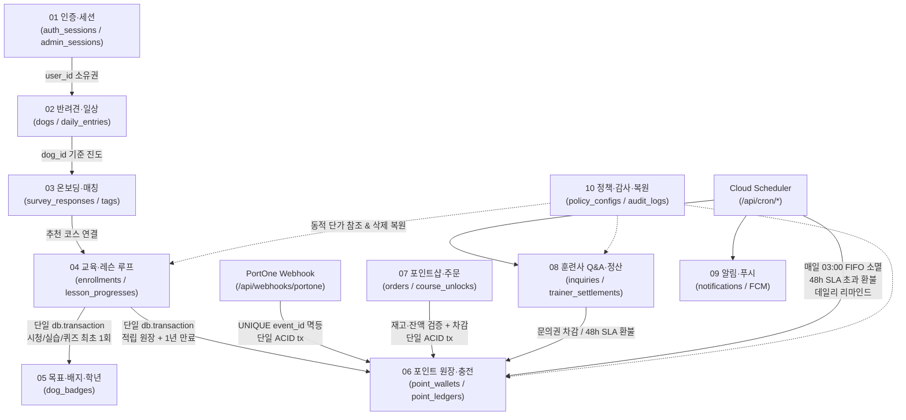

# 와글(Waggle) 전역 DB 무결성 규약 및 모듈 연관맵 (`00_2_Global_DB_&_Relation_Map`)

> **문서 역할**: 10개 도메인 폴더(`01 ~ 10`)에 걸친 **총 61개 PostgreSQL 18 물리 테이블(`54개 MUTABLE` + `7개 APPEND_ONLY`)의 단일 소유권(Single-Owner) 배정 · PostgreSQL 물리 타입 및 7대 감사 컬럼 표준 · 소프트 삭제(`is_deleted`) 네이티브 부분 유니크 인덱스(`WHERE is_deleted = false`) 해법 · 전역 행 잠금 순서 · 결제/포인트 ACID 및 Cron 연관 맵**을 정의하는 데이터 무결성 최고 기준서(SSOT · 2026-11-23 현행화)이다.  
> **연결 문서**: [00_1_전체기능_총괄명세.md](./00_1_전체기능_총괄명세.md) | [00_0_GRILL_ME_결정대장.md](./00_0_GRILL_ME_결정대장.md)

---

## 1. PostgreSQL 18 / Drizzle ORM (`pg-core`) 전역 물리 설계 7대 불변 규약

### 1.1 명명 규칙 및 기본 타입 표준
1. **케이스 표준**: 모든 물리 테이블명(복수형)과 컬럼명은 `snake_case`로 통일하며, Drizzle 스키마 객체 프로퍼티만 `camelCase`로 매핑한다. (단일 `public` 스키마 사용, 구 `multiSchema` 미사용)
2. **Primary Key (`id`)**: 전 테이블 **`BIGINT GENERATED ALWAYS AS IDENTITY PRIMARY KEY`** 단일 대리키를 사용한다 (`GM-101`).
3. **금액 / 포인트 / 수량 (부동소수점 오차 0%)**:
   - 모든 원화 결제액·정산액·상품가·포인트 잔액·원장 증감액은 **`BIGINT`**(정수, `REAL`/`DOUBLE PRECISION` 절대 금지)으로 저장한다.
   - 체중(kg)·비율(%)·가중치처럼 소수점이 필수인 컬럼만 **`NUMERIC(6, 2)`** 또는 **`NUMERIC(5, 2)`**를 사용한다.
4. **일시 (`Date & Time`)**: 일자는 `DATE`, 시각은 타임존 포함 **`TIMESTAMPTZ`**(`TIMESTAMP(3) WITH TIME ZONE`)를 사용한다.
5. **참조 무결성**: `ON DELETE CASCADE`를 전면 금지하고 **`ON DELETE RESTRICT`**(또는 논리 참조)를 원칙으로 하여 서비스 계층의 참조 삭제 차단(`CanDelete`)을 강제한다.
6. **설정·상수 단일 원천 (`GM-011`, 코드 Fallback 0% & Fail-Fast)**: 코드 내부에 비즈니스 정책 기본 상수나 임의 Fallback을 두지 않는다. 인프라·세션 상수는 루트 `.env`(Zod 검증), 비즈니스 운영 정책(`GM-104·105·106` 포함)은 PostgreSQL `policy_configs`(`seed.ts` 1회 적재 ➔ `/admin/policies` 관리 ➔ 오픈 시 확정 고정)에서만 읽으며, 필수 키 누락 시 즉시 명시적 에러(Fail-Fast)를 발생시킨다. 적립은 지급 시점 DB 정책값 그대로 원장에 기록하고, 환불(Q&A SLA 초과 · 주문 취소)은 원본 거래의 실제 결제/차감액(`paid_points`)을 기준으로 처리한다.

### 1.2 전 테이블 7대 감사(Audit) & 소프트 삭제 컬럼 필수화
- **`MUTABLE` 일반·마스터·트랜잭션 테이블 (54종 전수 필수 7개 컬럼)**:
  1. `created_at TIMESTAMPTZ NOT NULL DEFAULT NOW()`
  2. `created_by BIGINT NULL` (사용자/관리자 ID, 초기 시드/배치/웹훅 시에만 `NULL`)
  3. `updated_at TIMESTAMPTZ NOT NULL DEFAULT NOW()` (Drizzle `$onUpdate` / Service 계층 갱신)
  4. `updated_by BIGINT NULL`
  5. `is_deleted BOOLEAN NOT NULL DEFAULT FALSE` (`false`: 활성, `true`: 소프트 삭제)
  6. `deleted_at TIMESTAMPTZ NULL` (복원 시 `NULL` 초기화)
  7. `deleted_by BIGINT NULL` (복원 시 `NULL` 초기화)
- **`APPEND_ONLY` 불변 로그/원장/시도 테이블 (수정·삭제 원천 금지 예외 7종)**:
  - 대상: `point_ledgers`, `payment_event_logs`, `audit_logs`, `policy_config_histories`, `notifications`, `quiz_attempts`, `level_test_attempts`
  - 생성 시점 `created_at TIMESTAMPTZ NOT NULL DEFAULT NOW()` 및 행위자 ID만 보유하며 물리 `DELETE` 및 일반 `UPDATE`를 금지한다 *(단, `notifications`는 수신 확인 `is_read`, `read_at` 단방향 갱신만, `point_ledgers`는 FIFO 소진 잔여량 `remaining_amount` 원장 트랜지션만 허용)*.

### 1.3 PostgreSQL 소프트 삭제 재등록 유니크 충돌 방지 표준 (Partial Unique Index)
물리 `DELETE` 없이 `is_deleted = true`로 숨겼을 때 동일 이메일/코드/태그 재등록 충돌을 방지하기 위해 PostgreSQL 네이티브 **부분 유니크 인덱스(Partial Unique Index)**를 표준 적용한다:
```sql
CREATE UNIQUE INDEX uq_accounts_provider_active
  ON accounts (provider, provider_id)
  WHERE is_deleted = FALSE;
```
*(별도 가상 컬럼 없이 활성 행(`is_deleted = FALSE`)에만 유니크 제약을 걸므로, 소프트 삭제 후 재등록과 관리자 원클릭 복원(`is_deleted = FALSE`)이 모두 깔끔하게 동작한다.)*

---

## 2. 10개 도메인 폴더별 61개 물리 테이블 Single-Owner 배정표

> 구버전 Prisma 58개 모델 중 JWT용 `RefreshToken`을 폐기하고, DB SHA-256 세션 이원화용 `auth_sessions` · `admin_sessions` · `admin_otp_codes` 3종 및 구매 확정 후기용 `product_reviews` 1종을 신설해 **총 61개 물리 테이블**을 10개 도메인에 중복 없이 배정한다.

| 폴더 | Wave | 소유 테이블 수 | 소유 물리 테이블 목록 (`MUTABLE` / **`APPEND_ONLY`**) | 구 Prisma 모델 대응 |
| :--- | :---: | :---: | :--- | :--- |
| **`01_기반_인증_소개`** | W1 | **7** | `accounts`, `users`, `devices`, `auth_sessions`, `admins`, `admin_sessions`, `admin_otp_codes` | `Account`, `User`, `Device`, `Admin` (+ 세션/OTP 3종 신설, `RefreshToken` 폐기) |
| **`02_반려견_일상기록_접종`** | W1 | **7** | `dogs`, `breeds`, `anniversaries`, `daily_entries`, `daily_entry_stickers`, `common_codes`, `vaccination_records` | `Dog`, `Breed`, `Anniversary`, `DailyEntry`, `DailyEntrySticker`, `CommonCode`, `VaccinationRecord` (견종 마스터 40종 풀셋) |
| **`03_온보딩_설문_매칭_레벨테스트`** | W1 | **8** | `survey_questions`, `survey_answers`, `survey_responses`, `tags`, `course_tags`, `answer_tags`, `level_tests`, **`level_test_attempts`** | `SurveyQuestion`, `SurveyAnswer`, `SurveyResponse`, `Tag`, `CourseTag`, `AnswerTag`, `LevelTest`, `LevelTestAttempt` |
| **`04_교육커리큘럼_레슨루프`** | W1 | **10** | `courses`, `units`, `lessons`, `lesson_steps`, `practice_checklists`, `quizzes`, `quiz_questions`, **`quiz_attempts`**, `enrollments`, `lesson_progresses` | `Course`, `Unit`, `Lesson`, `LessonStep`, `PracticeChecklist`, `Quiz`, `QuizQuestion`, `QuizAttempt`, `Enrollment`, `LessonProgress` |
| **`05_게이미피케이션_목표_배지_학년`** | W1 | **3** | `daily_goals`, `badges`, `dog_badges` | `DailyGoal`, `Badge`, `DogBadge` |
| **`06_포인트원장_충전결제`** | W1/2 | **4** | `point_wallets`, **`point_ledgers`**, **`payment_event_logs`**, `point_recharges` | `PointWallet`, `PointLedger`, `PaymentEventLog`, `PointRecharge` (+ `idempotency_key` Partial UNIQUE, 환불 컬럼) |
| **`07_포인트샵_주문_배송`** | W2 | **12** | `product_categories`, `products`, `product_images`, `product_variants`, `carts`, `cart_items`, `addresses`, `orders`, `order_items`, `shipments`, `course_unlocks`, `product_reviews` | 기존 11종 + `product_reviews` 신설 (`products.detail_html`, `orders.confirmed_at`/`idempotency_key` 확장) |
| **`08_훈련사_영상QA_월정산`** | W2 | **4** | `trainers`, `trainer_tags`, `inquiries`, `trainer_settlements` | `Trainer`, `TrainerTag`, `Inquiry`, `TrainerSettlement` (+ `inquiries.idempotency_key`) |
| **`09_알림_푸시_배치`** | W2 | **2** | `notification_templates`, **`notifications`** | `NotificationTemplate`, `Notification` |
| **`10_운영공통_정책_배너_감사복원`** | W1 | **4** | **`audit_logs`**, `banners`, `policy_configs`, **`policy_config_histories`** | `AuditLog`, `Banner`, `PolicyConfig`, `PolicyConfigHistory` |
| **합계** | - | **61** | **`54 MUTABLE` + `7 APPEND_ONLY` = 61 Physical Tables** | 기존 58 ➔ `-1` `+4` = **61** |

---

## 3. 핵심 도메인 간 트랜잭션 · 원장 · Cron 연관 맵



---

## 4. 교차 도메인 핵심 트랜잭션 계약 (Stage 2 상세화 기준)
1. **중복 로그인 즉시 폐기 (`01`)**: 로그인 트랜잭션에서 `UPDATE auth_sessions SET revoked_date = NOW(3), revoked_reason = 'DUPLICATE_LOGIN' WHERE user_id = ? AND revoked_date IS NULL` 후 신규 SHA-256 해시 세션 INSERT.
2. **레슨 단계 완료 보상 (`04` + `05` + `06`)**: `lesson_progresses` 행 잠금(`FOR UPDATE`) ➔ 해당 단계(`watch`/`practice`/`quiz`) 보상 플래그 `0 -> 1` 조건부 전이 ➔ `point_ledgers` INSERT(멱등키 `lesson:{dog_id}:{lesson_id}:{step}`) + `point_wallets.balance` UPDATE ➔ 퀴즈 통과 시 유닛/코스 완주 배지(`dog_badges`) 및 학년 동기 평가.
3. **결제 웹훅 충전 (`06`)**: HMAC 서명 검증 ➔ PortOne API 재조회 금액 대조 ➔ 단일 `db.transaction`(`payment_event_logs` UNIQUE INSERT ➔ `point_recharges` `PENDING -> PAID` ➔ `point_ledgers` INSERT ➔ `point_wallets` UPDATE) ➔ 응답 후 `after()` 단건 알림.
4. **포인트샵 주문 (`07` + `06`)**: **전역 잠금 순서(`point_wallets` ➔ `carts` ➔ `products`/`product_variants` `id ASC` ➔ `point_ledgers` `id ASC`)** 준수 + `expectedWalletBalance` Stale 탭 차단(`BALANCE_STALE`) + `orders.idempotency_key` Partial UNIQUE + `PREMIUM_UNLOCK` 중복 구매 차단(`ALREADY_UNLOCKED`) ➔ FIFO 차감 + 주문/배송지 저장.
5. **구매 확정 후기 & 1회 적립 (`07` + `06`)**: `point_wallets` 선잠금 ➔ `order_items` `FOR UPDATE` + `orders.status = 'CONFIRMED'`·`PHYSICAL` 검증 ➔ `product_reviews` INSERT(`uq_product_reviews_order_item_active`) + `REVIEW_REWARD` 원장 적립(멱등키 `review-reward:{reviewId}`).
6. **배치 4종 (`09` + `06` + `07` + `08`)**: Cloud Scheduler `POST /api/cron/{expire-points,inquiry-sla,confirm-orders,daily-reminder}` (`CRON_SECRET` 헤더 검증) ➔ 전역 잠금 순서 + 멱등키 적용.
